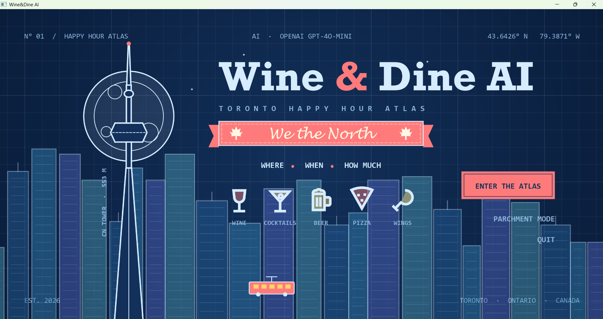
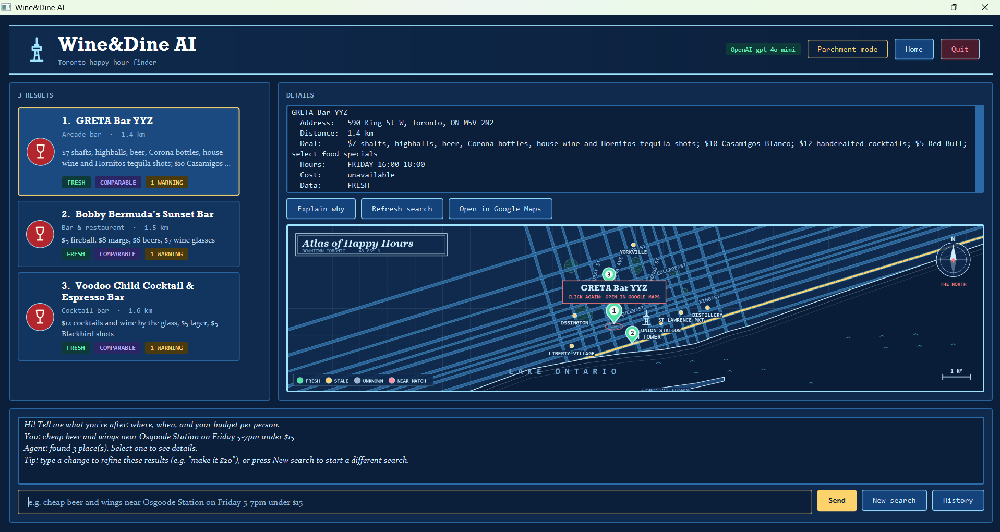

# Wine&Dine AI

A Java AI agent that finds Toronto restaurants and happy-hour deals from a plain-language request
(budget, time, location, food/drink preferences). A language model understands the request, asks
follow-up questions and explains results; Java code does the filtering, ranking, freshness checks,
history and map links, so recommendations only ever come from verified data.

EECS3311 Fall 2026 project, Stage 2 (implementation).

## Prerequisites

- Java 17 or newer (JDK)
- Maven 3.8+
- An OpenAI API key (optional: without one the app uses an offline rule-based stand-in)

## Setup

```bash
git clone https://github.com/yashnagarg/Wine-Dine-AI-.git
cd Wine-Dine-AI-
mvn compile
```

### Configuration (API key)

```bash
cp .env.example .env      # Windows: copy .env.example .env
```

Open `.env` and replace `YOUR_LOCAL_API_KEY_HERE` with your own key. `.env` is listed in `.gitignore`,
so it is never committed. The key is read only by `AppConfig` and is never printed or logged.
For a demo without a key, set `USE_MOCK_LLM=true` in `.env` (or leave the key as the placeholder).

## Run

Command line:

```bash
mvn -q exec:java "-Dexec.mainClass=com.winedine.Main"
```

Graphical interface (JavaFX):

```bash
mvn javafx:run
```

## The GUI

`mvn javafx:run` opens on a cover page (CN Tower skyline, "Enter the atlas"). Day is a parchment brochure and
night is a blueprint; switch with the mode link on the cover or the button in the header. Home goes back to the
cover and Quit closes the app.

- Type a request in the box at the bottom. Result cards show an icon, distance, the deal and a FRESH / STALE /
  UNKNOWN badge.
- The atlas map shows one numbered pin per result. Click a pin to select it; click the selected pin again (or
  press "Open in Google Maps") to open the venue in your browser.
- "Explain why", "Refresh search", "New search" and "History" work on the selected result or search.

### Screenshots

| Cover (parchment) | Results and atlas (blueprint) |
|---|---|
|  |  |

## Example usage

```
> cheap beer and wings near Osgoode Station on Friday 5-7pm under $15
Searching: near osgoode station, FRIDAY, 17:00-19:00, up to $15.0 pp, ...
1. Example Pub (Pub) - 0.4 km - $6 pints, $5 wings
> /explain 1          why this result was recommended
> /map 1              OpenStreetMap and Google Maps links
> make it $20         refine the search in plain words
> closest first       change the ranking
> /history            saved searches (older than 7 days are marked outdated)
> /open 1             reopen a saved search, then /refresh to search again with current data
```

If details are missing (budget, time), the agent asks up to two follow-up questions; type `skip` to
search anyway. A location is always required.

## Tests

```bash
mvn test
```

## Project layout

| Package | Purpose |
|---|---|
| `com.winedine.model` | Data classes: constraints, restaurants, deals, results, history, `ResponseType` enum |
| `com.winedine.config` | `AppConfig` - reads `.env` / environment variables |
| `com.winedine.data` | `RestaurantDataProvider`, `ProviderFactory` (Factory Method), curated JSON provider |
| `com.winedine.service` | Constraint filters, ranking strategies (Strategy), `RecommendationService`, `HistoryService` |
| `com.winedine.llm` | `LLMClient`, `OpenAILLMClient` (Adapter), `MockLLMClient` |
| `com.winedine.agent` | `RestaurantAgent` - conversation logic |
| `com.winedine.controller` | `AgentController` (Facade / MVC controller) |
| `com.winedine.ui` | CLI, result formatting, map links |
| `com.winedine.ui.gui` | JavaFX GUI: `GuiApp`, `CoverView`, `AtlasMapView`, icons, fonts (stylesheet in `src/main/resources`) |

## Data

`data/restaurants.json` is the curated dataset (real Toronto restaurants, their happy-hour deals, and landmarks),
entered by hand from published happy-hour menus. Unknown prices, hours or dates are stored as `null` and shown as
"unavailable" or "freshness unknown"; nothing is guessed. Coordinates are approximate.

`src/test/resources/test-restaurants.json` is a test fixture with extra fictional venues that are deliberately
stale, unpriced or without coordinates. To see the warnings in a demo, set
`DATASET_PATH=src/test/resources/test-restaurants.json` in `.env`.